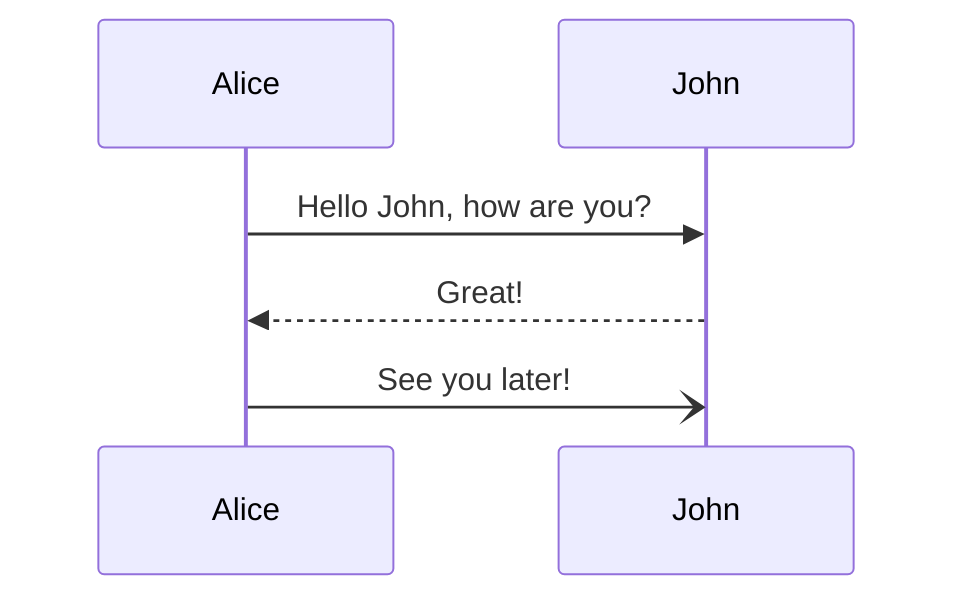

# Markdown-Slides

Generate HTML slides from Markdown files

<!-- slide -->

## Features

- ✨ Beautiful slides including a pretty title slide
- 📱 Slides are fully responsive for mobile devices and small screens
- 🌓 Light and Dark Mode
- 🖨️ Print styles to create PDFs in the browser
- ♿ HTML slides are accessible
- 📖 Table of contents to jump to specific slides
- 💡 Code highlighting with highlight.js
- ➗ Equations with MathJax
- 📈 Diagrams with Mermaid
- 💬 Alerts and footnotes like on GitHub
- #️⃣ Slide numbers will be generated automatically
- 📅 Date of the build will be included as a versioning
- 📚 Supports multiple markdown files to split your presentation in subslides
- ➡️ Use space, arrow and page keys to navigate
- 🎨 Easily override the Stuttgart Media University (HDM) theme with custom colors and logos
- 🚀 Publish your slides with GitLab or GitHub Pages

<!-- slide -->

## Requirements for local builds

If you want to build the slides locally, Node or Docker is required.

### How to use it

Create one (README.md) or more markdown files in the root of your directory (e.g. a git repository) and start typing.

To start a new slide use a comment `<!-- slide -->`.

Example:

```markdown
# Lecture Title

@module[123456]
@semester[Summer 2025]

Korbinian Kuhn [kuhnko@](mailto:kuhnko@hdm-stuttgart.de)

<!-- slide -->

## Content

- What we will do
- What you will learn
```

Build the slides with Node:

```bash
npx @korbiniankuhn/markdown-slides
```

Or with Docker:

```bash
docker run --rm -v "$(pwd)":/app -w /app node:alpine sh -c "npx @korbiniankuhn/markdown-slides"
```

Serve slides (you can also open the index.html file locally, but you might run into CORS issues e.g. for MathJax):

```bash
npx http-server -c-1 public
```

Updating to a new version? The [changelog](https://github.com/KorbinianKuhn/markdown-slides/blob/main/CHANGELOG.md) lists upgrade notes with commands to find the places in your slides that need changes.

<!-- slide -->

## CLI parameters

Convert current directory to slides into a output directory `public`:

```bash
npx @korbiniankuhn/markdown-slides
```

Only use certain files and directories of the input directory, by name or with glob patterns like in `.gitignore`. Quote patterns with `*`, so the shell passes them on:

```bash
npx @korbiniankuhn/markdown-slides --allowed-files README.md 'chapter-*.md' images '*.css'
npx @korbiniankuhn/markdown-slides --ignored-files '*.pdf' drafts/
```

CLI arguments:

| Argument           | Description                                                                                   | Default   | Required |
| ------------------ | --------------------------------------------------------------------------------------------- | --------- | -------- |
| `-i`, `--in`       | Input directory                                                                               | .         | false    |
| `-o`, `--out`      | Output directory                                                                              | public    | false    |
| `-l`, `--language` | `en` or `de`: language of the page, the default institution, alert titles and footnote labels | en        | false    |
| `--institution`    | Custom institution name                                                                       | undefined | false    |
| `--title`          | Lecture title for the back link on sub-pages, otherwise the first headline is used            | undefined | false    |
| `--toc-numbering`  | Number the headings, `true` or `false`                                                        | true      | false    |
| `--allowed-files`  | Only use files and directories of the input directory that match these names or patterns      | undefined | false    |
| `--ignored-files`  | Ignore files and directories that match these names or patterns (dotfiles are always ignored) | undefined | false    |

<!-- slide -->

## Writing slides

<!-- slide -->

### Title slide

Everything before the first `<!-- slide -->` is the title slide:

```markdown
# Lecture Title

@module[123456]
@semester[Summer 2026]

Jane Doe [jane@](mailto:jane@example.com)
```

- The first `#` heading is the title of the page, and of the lecture on sub-pages (or `--title`)
- `@module[…]` and `@semester[…]` are shown as labels
- The institution comes from `--institution`, the date of the build is added automatically

<!-- slide -->

### Slides

| Identifier         | Description                                    |
| ------------------ | ---------------------------------------------- |
| `<!-- slide -->`   | Starts a new slide, on a line of its own       |
| `## Heading`       | Numbered and listed in the table of contents   |
| `### Heading`      | Numbered and listed in the table of contents   |
| `<!-- comment -->` | Other comments are removed, e.g. notes for you |

All of [GitHub Flavored Markdown](https://github.github.com/gfm/) works, e.g. tables, task lists and ~~strikethrough~~.

<!-- slide -->

### Spacer

| Identifier         | Description                 |
| ------------------ | --------------------------- |
| `:spacer`          | Medium vertical spacer      |
| `:spacer{size=sm}` | Small vertical spacer       |
| `:spacer{size=md}` | Medium vertical spacer      |
| `:spacer{size=lg}` | Large vertical spacer       |
| `:spacer{size=xl}` | Extra-Large vertical spacer |

<!-- slide -->

### Layout

<!-- row -->
<!-- col -->

| Identifier         | Description            |
| ------------------ | ---------------------- |
| `<!-- row -->`     | Starts a row container |
| `<!-- row:end -->` | Ends a row container   |
| `<!-- col -->`     | Starts a col container |
| `<!-- col:end -->` | Ends a col container   |

Columns have the same width. On phones, they are shown below each other.

<!-- col:end -->
<!-- col -->

```markdown
<!-- row -->
<!-- col -->

Left

<!-- col:end -->
<!-- col -->

Right

<!-- col:end -->
<!-- row:end -->
```

<!-- col:end -->
<!-- row:end -->

<!-- slide -->

### Images and videos

Set the width and alignment of an image or video with an attribute block directly after it. The alt text stays as it is.

| Attribute | Values                                      | Default       |
| --------- | ------------------------------------------- | ------------- |
| `width`   | Percentage or pixels, e.g. `70%` or `400px` | Original size |
| `align`   | `left`, `center` or `right`                 | `center`      |

```markdown
{width=70% align=left}

{width=50%}
```

`.mp4` and `.webm` files are shown as videos. The alt text describes the image or video for screen readers; without one, the build warns. Invalid attributes stop the build.

<!-- slide -->

### Code

Code blocks are highlighted with [highlight.js](https://highlightjs.org/) when the language is set, and have a button to copy the code:

```python
def greet(name):
    return f"Hello {name}!"
```

Long lines scroll sideways on the slide and wrap when printed.

<!-- slide -->

### Multiple files and links

- Every Markdown file in the input directory becomes a page: `README.md` is `index.html` (required), `chapter-1.md` is `chapter-1.html`
- Link to another page with its Markdown file: `[Chapter 1](chapter-1.md)`. Sub-pages link back to `index.html` with the lecture title.
- All other files and directories, e.g. `images`, are copied as they are, so relative links keep working
- Links to other websites open in a new tab

<!-- slide -->

### Alerts

Highlight a note, tip or warning like on GitHub. The title follows `--language`.

```markdown
> [!TIP]
> Build the slides locally before you push.
```

> [!TIP]
> Build the slides locally before you push.

Also available: `[!NOTE]`, `[!IMPORTANT]`, `[!WARNING]` and `[!CAUTION]`.

<!-- slide -->

### Footnotes

Footnotes[^footnotes] are shown at the bottom of the slide that refers to them, and numbered per slide.

```markdown
Footnotes[^footnotes] are shown at the bottom of the slide.

[^footnotes]: Defined anywhere in the file.
```

[^footnotes]: Defined anywhere in the file, like on GitHub.

<!-- slide -->

### MathJax

LaTex equations are converted to equations with MathJax, including all accessibility features:

Centered Math (`\\[ ... \\]`):

\\[ x = {-b \pm \sqrt{b^2-4ac} \over 2a} \\]

Inline Math (`\\( ... \\)`):

\\( x = {-b \pm \sqrt{b^2-4ac} \over 2a} \\)

<!-- slide -->

### MermaidJS

Mermaid is supported, fits in nicely with the colors of the theme and automatically reacts to the light or dark mode:



<!-- slide -->

## Presenting

<!-- slide -->

### Navigation

| Key                           | Action         |
| ----------------------------- | -------------- |
| Right arrow, Page Down, Space | Next slide     |
| Left arrow, Page Up           | Previous slide |

- The **Fullscreen** button on the title slide shows the slides without the browser around them
- The button with the title at the top left opens the table of contents, which also has buttons for the light and dark theme (**Auto** follows the system).
- Scrolling works too, e.g. for slides that are longer than the screen

<!-- slide -->

### Printing and PDF

Print the page in the browser (e.g. <kbd>Ctrl</kbd>+<kbd>P</kbd>, or <kbd>Cmd</kbd>+<kbd>P</kbd> on a Mac) and choose "Save as PDF":

- Every `##` heading starts a new page, and pages use the light theme
- Links to other websites show their address
- Videos show their description and link instead

<!-- slide -->

## Custom Theme

Override the default theme with these files in the root of your project:

| File                                 | Use                                |
| ------------------------------------ | ---------------------------------- |
| `logo-light.svg` and `logo-dark.svg` | Logos for the light and dark theme |
| `favicon.ico`                        | Icon in the browser tab            |
| `*.css`                              | Styles, included in every page     |
| `*.js`                               | Scripts, included in every page    |

Setting the primary color is usually enough. In the dark theme, it is lightened where needed, so text stays readable:

```css
:root {
  --color-primary: blue;
}
```

<!-- slide -->

## Publish with GitLab Pages

Add a `.gitlab-ci.yml` to your repository. Every push to the default branch publishes the slides:

```yaml
pages:
  image: node:lts-alpine
  script:
    - npx @korbiniankuhn/markdown-slides -o public
  artifacts:
    paths:
      - public
  rules:
    - if: $CI_COMMIT_BRANCH == $CI_DEFAULT_BRANCH
```

Add CLI parameters to the `npx` line, e.g. `--language de`. Pin a version (`@korbiniankuhn/markdown-slides@1.0.0`) to update on your own schedule.

<!-- slide -->

## Publish with GitHub Pages

Set **Settings → Pages → Source** to **GitHub Actions**, and add `.github/workflows/slides.yml`:

```yaml
name: Slides
on:
  push:
    branches: [main]
permissions:
  contents: read
  pages: write
  id-token: write
jobs:
  deploy:
    runs-on: ubuntu-latest
    environment:
      name: github-pages
      url: ${{ steps.deployment.outputs.page_url }}
    steps:
      - uses: actions/checkout@v7
      - uses: actions/setup-node@v7
        with:
          node-version: lts/*
      - run: npx @korbiniankuhn/markdown-slides -o public
      - uses: actions/upload-pages-artifact@v5
        with:
          path: public
      - id: deployment
        uses: actions/deploy-pages@v5
```
